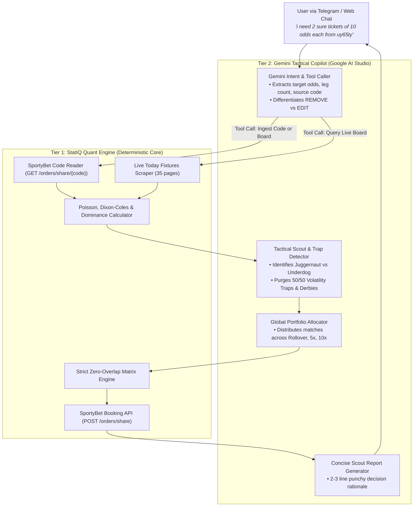
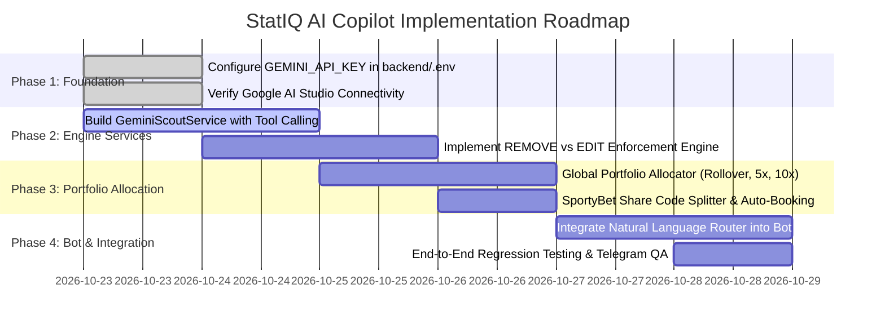

# PRD: StatIQ AI Copilot & Intelligent Portfolio Engine
**Author:** DeepMind Agentic Pair Programming & StatIQ Architecture  
**Status:** Approved for Implementation  
**Version:** 1.0.0  
**Target Platform:** StatIQ Backend (Python/FastAPI), Telegram Bot Remote, Web Ticket Builder (React)  

---

## 1. Executive Summary & Core Mission

StatIQ currently operates with a high-precision mathematical core: **Poisson / Dixon-Coles goal expectation models, implied probability scoring, dominance ratios, zero-overlap isolation matrices, and automated SportyBet booking APIs**.

This PRD defines the integration of **Google AI Studio (Gemini 1.5/2.0 Flash)** as an **Intelligent Tactical Copilot & Portfolio Allocator** on top of the existing quant engine. 

### Core Guarantee: Zero Destruction of Mathematical Engine
> [!IMPORTANT]
> **The underlying predictive engine is NOT being replaced, weakened, or removed.**  
> The quant engine remains the **Calculator & Executor** (calculating odds, scraping SportyBet, calculating probabilities, enforcing zero overlap, and booking live tickets).  
> Gemini acts as the **Tactical Scout & Conversational Copilot** (interpreting natural language, detecting tactical traps, performing global portfolio distribution, and generating concise human-readable explanations).

---

## 2. System Architecture: The Two-Tier Hybrid Intelligence Model



---

## 3. Key Functional Epics & Requirements

### Epic 1: Strict Distinction Between `REMOVE` and `EDIT` Modes
The AI must never confuse these two operational modes:

| Feature | `REMOVE` (Risk Purge Mode) | `EDIT` (Market Upgrade Mode) |
| :--- | :--- | :--- |
| **User Intent** | *"Remove the risky games from code ABC"* | *"Edit / upgrade the games in code ABC"* |
| **Market Treatment** | **Keeps original markets 100% as-is**. Does not modify the user's bet types. | **Upgrades markets**. Replaces Straight Win (1) with Double Chance (1X) or Over 1.5 Goals. |
| **Fixture Treatment** | **Drops fragile / volatile matches** (low Poisson probability $<70\%$, 50/50 derbies). | **Keeps 100% of fixtures**. Modifies markets to make them safe. |
| **Retention Rule** | Minimum retention floor: must retain $\ge 70\%-80\%$ of matches. Never over-purge. | Retains $100\%$ of original matches. |
| **Output** | High-probability core ticket with original markets preserved. | Maximized safety ticket with upgraded SportyBet cushions. |

---

### Epic 2: The "Menu & Sommelier" Model (Zero Hallucination)
To guarantee 100% SportyBet booking success (`bizCode: 10000`), the AI is strictly forbidden from inventing bets, odds, or market IDs:

> [!CAUTION]
> **Anti-Hallucination Law**: Gemini will never fabricate a prediction out of thin air.  
> 1. **StatIQ Quant Engine (The Chef)** generates the **Verified Menu** of real, active, loadable SportyBet markets (with real `marketId`, `outcomeId`, `specifier`, and live odds).  
> 2. **Gemini AI (The Sommelier)** evaluates the tactical match dynamics and **selects the superior option from the verified menu**.

* **Example**: For *Torino vs Monza*, StatIQ extracts verified options: `Over 1.5 @ 1.24`, `Torino 1X @ 1.22`, and `Torino Over 0.5 @ 1.14`. Gemini inspects the tactical matchup and selects `Over 1.5` because Monza concedes late while Torino's home scoring rate is 82%.

---

### Epic 3: Global Multi-Tier Portfolio Distribution (Daily Automation & Custom Slips)
Instead of greedy first-come-first-served fixture allocation (where Slip 1 consumes the best games and leaves scraps for Slips 2 & 3), Gemini acts as a **Global Portfolio Allocator**:

```
                              ┌──────────────────────────────────┐
                              │  Daily Vetted Pool (Top ~35-40   │
                              │    Matches from SportyBet)       │
                              └─────────────────┬────────────────┘
                                                │
                                                ▼
                         ┌───────────────────────────────────────────────┐
                         │      GEMINI PORTFOLIO ALLOCATOR               │
                         │   Global Vetting & Archetype Assignment       │
                         └──────┬───────────────┼───────────────┬────────┘
                                │               │               │
                                ▼               ▼               ▼
                      ┌──────────────────┐ ┌──────────┐ ┌───────────────┐
                      │  ROLLOVER VAULT  │ │PRECISION │ │  MEGA MULTI   │
                      │   (1.5x / 2.0x)  │ │  (5.0x)  │ │    (10.0x)    │
                      └──────────────────┘ └──────────┘ └───────────────┘
```

#### Multi-Tier Slips Breakdown:
1. **Slip 1: Rollover Vault (`1.50x` or `2.00x` target)**:
   - **Archetype**: *Titanium Fortress*.
   - **Rule**: Exactly 3 banker matches for 1.50x corridor (or 2–4 for 2.00x).
   - **Criteria**: Uncontested home dominance ($\text{Dominance Ratio} \ge 2.5$), zero derbies, $\ge 85\%$ home scoring consistency, single-leg win prob $\ge 80\%$.
2. **Slip 2: Precision Multiplier (`5.00x` target)**:
   - **Archetype**: *High-Tempo Goal Engines*.
   - **Rule**: 6 to 8 vetted matches.
   - **Criteria**: High-tempo leagues (Bundesliga, Eredivisie, Premier League), match expected goals ($xG \ge 2.70$), win prob $\ge 76\%$.
3. **Slip 3: Mega Multiplier (`10.00x` target)**:
   - **Archetype**: *Extended Dominance & Zero-Overlap Partition*.
   - **Rule**: 10 to 13 matches with **100% Zero Overlap** (completely isolated from Slips 1 & 2).
   - **Criteria**: High-floor Double Chance selections (`1X` / `X2`), Tier-2 major flight dominators.
4. **Slip 4 (Optional): Monster Acca (`20.00x` target)**:
   - Max dominance accumulator with calendar-adaptive isolation.

---

### Epic 4: Natural Language Telegram Interface & Code Scrubbing

Users can speak naturally in Telegram without knowing code syntax, while power-user slash commands remain 100% active.

#### Natural Query Examples & Execution Mapping:
* **User Query**: *"i need 2 sure tickets of 10 odds each from uy65ty"*
  - **Tool Invoked**: `process_code_split(code="uy65ty", target_odds=10.0, ticket_count=2, mode="REMOVE")`
  - **Action**: Ingests code `uy65ty`, purges genuine 50/50 traps without modifying surviving markets, partitions surviving pool into 2 zero-overlap 10x slips, books both on SportyBet, and sends live share links with a 2-line explanation.
* **User Query**: *"audit code ABC12 and upgrade all risky straight wins"*
  - **Tool Invoked**: `process_code_edit(code="ABC12", mode="EDIT")`
* **User Query**: *"give me a 50 odds weekend longshot from dominant teams"*
  - **Tool Invoked**: `generate_custom_slip(target_odds=50.0, time_horizon="WEEKEND", style="DOMINANT_FAVORITES")`
* **User Query**: *"why did you pick Alaves today?"*
  - **Tool Invoked**: `explain_fixture_selection(team="Alaves")`

#### Fast-Path Preservation:
Existing commands (`/odds`, `/duo`, `/remove`, `/edit`, `/auto`, `/dispatch`, `/schedule`) bypass the LLM and execute instantly in $<50$ms.

---

## 4. Technical Architecture & Implementation Details

### Service Layer: `GeminiScoutService`
Located at `backend/app/services/gemini_scout_service.py`:
* **SDK**: `google-genai` or direct HTTP calls to `https://generativelanguage.googleapis.com/v1beta/models/gemini-1.5-flash:generateContent`.
* **API Key**: `GEMINI_API_KEY` stored securely in `backend/.env`.
* **Model**: `gemini-1.5-flash` (200ms–400ms latency, cost-effective, high reasoning accuracy).
* **Tool Calling Registry**:
  1. `tool_read_sportybet_code(code: str)` ➔ Calls `BookmakerAdapter.get_ticket_details`.
  2. `tool_query_daily_candidates(time_horizon: str)` ➔ Calls `EliteRolloverEngine.evaluate_elite_rollover_candidates`.
  3. `tool_book_ticket(selections: list)` ➔ Calls `EliteRolloverEngine._request_sportybet_share_code`.
  4. `tool_reedit_ticket(code: str, mode: str, target_odds: float)` ➔ Calls `TicketReEditor`.

### Telegram Bot Routing in `telegram_bot_service.py`
```python
# Pseudo-routing logic:
if text.startswith("/"):
    # Immediate deterministic fast-path (unchanged)
    return handle_slash_command(text)
elif is_raw_booking_code(text):
    # Standalone code pasted -> interactive inline buttons (unchanged)
    return handle_raw_code_detected(text)
else:
    # Free-form natural language -> routed to GeminiScoutService
    return await gemini_scout_service.handle_conversational_message(chat_id, text)
```

---

## 5. Risk Assessment & Mitigations

| Risk | Impact | Mitigation Strategy |
| :--- | :--- | :--- |
| **API Timeout / Network Lag** | Telegram message delay | 8-second hard timeout on Gemini API call. If timed out, fall back seamlessly to deterministic quant logic with notification. |
| **Over-Purging Games in REMOVE** | Too few games surviving to hit target odds | Strict minimum retention floor ($70\%-80\%$). AI is instructed to drop only verified 50/50 volatility traps and unverified low-tier games. |
| **Odds / Market Incompatibility** | SportyBet booking failure | Zero-hallucination policy: selections are sourced exclusively from live SportyBet market payloads. |
| **Rate Limiting** | Google AI Studio 429 errors | Built-in exponential backoff retry and local in-memory intent caching. |

---

## 6. Implementation Milestones



---

## 7. Approval & Sign-Off
This PRD captures all user requirements, safeguards, and architectural guarantees. Execution begins with **Phase 1 & Phase 2**.
